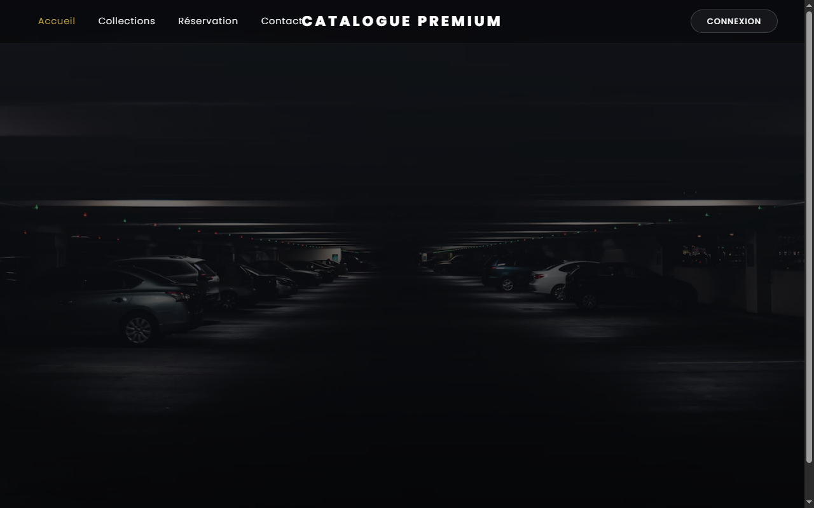
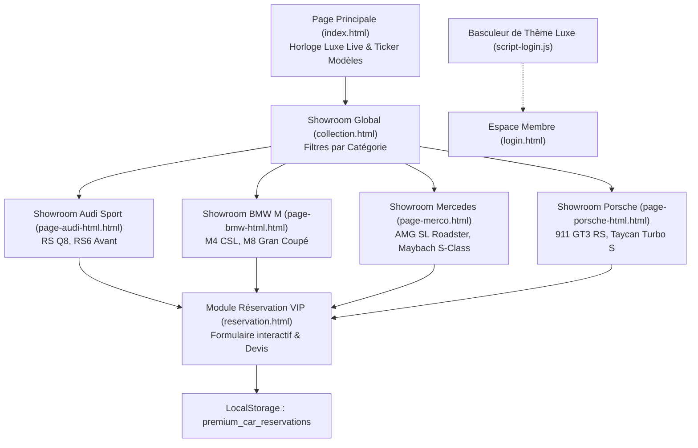

# Catalogue Premium — Voitures d'Exception

> **Plateforme web haut de gamme dédiée à la découverte, la comparaison et la réservation de véhicules de prestige.**

[](https://developer.mozilla.org/fr/docs/Web/HTML)
[](https://developer.mozilla.org/fr/docs/Web/CSS)
[](https://developer.mozilla.org/fr/docs/Web/JavaScript)
[](https://getbootstrap.com/)
[](https://mohammed-aichour.github.io/Catalogue-Premium-Voitures-d-Exception/)

<p align="center">
  
</p>

---

## 🌟 Présentation du Projet

**Catalogue Premium** est une plateforme web moderne conçue avec une direction artistique luxueuse et épurée. Elle met en scène une sélection exclusive de voitures d'exception des plus grandes manufactures allemandes : **Audi Sport, Mercedes-AMG / Maybach, BMW M, et Porsche**.

Le projet offre une expérience utilisateur immersive combinant typographie soignée, animations fluides en CSS3, widgets interactifs en JavaScript (dont une horloge tableau de bord dynamique et un système de filtrage), et formulaires de réservation.

* **Démo en ligne** : [https://mohammed-aichour.github.io/Catalogue-Premium-Voitures-d-Exception/](https://mohammed-aichour.github.io/Catalogue-Premium-Voitures-d-Exception/)

---

## 🏎️ Marques & Collections Mises en Avant

| Constructeur | Modèles Clés Présentés | Particularités |
|---|---|---|
| **Audi Sport** | Audi RS Q8 Performance, Audi RS6 Avant | Puissance Quattro, lignes dynamiques |
| **Mercedes-Benz** | Mercedes-AMG SL Roadster, Maybach S-Class | Luxe absolu, motorisations V8 BiTurbo |
| **BMW M** | BMW M4 CSL, BMW M8 Gran Coupé | Précision sportive, technologie M Power |
| **Porsche** | Porsche 911 GT3 RS, Porsche Taycan Turbo S | Héritage circuit, performance aérodynamique |

---

## ✨ Fonctionnalités & Pages du Site

1. **Page d'Accueil (`index.html`)** :
   * Bannière héroïque avec animations d'apparition séquencées.
   * Bandeau défilant (Ticker) des modèles disponibles.
   * **Horloge digitale de luxe** synchronisée en temps réel (heures, minutes, secondes et date).
2. **Collections & Vitrines par Marque (`collection.html`)** :
   * Présentation multi-panneaux avec split view interactif.
   * Fiches dédiées pour chaque marque (`page-audi-html.html`, `page-bmw-html.html`, `page-merco.html`, `page-porsche-html.html`).
3. **Module de Réservation (`reservation.html`)** :
   * Formulaire interactif de réservation de véhicule et d'options VIP.
   * Validation en direct des champs et sélecteurs de dates.
4. **Espace Contact & Authentification (`contact.html`, `login.html`)** :
   * Formulaire de contact stylisé et espace de connexion client sécurisé.

---

## 🏛️ Flux Utilisateur & Réservation VIP



---

## 🛠️ Stack Technique

* **Structure** : HTML5 sémantique, balisage SEO et balises OpenGraph.
* **Style & Design** : CSS3 moderne, variables CSS, Flexbox, CSS Grid, animations fluides `@keyframes` et Bootstrap 5.
* **Interactivité** : Vanilla JavaScript ES6+ (manipulation du DOM, horloge temps réel, validation de formulaires).
* **Typographie & Icônes** : Polices Google Fonts (Poppins), FontAwesome 6.

---

## 🚀 Utilisation & Lancement Local

Aucun outil de build complexe n'est requis. Pour lancer le projet en local :

1. **Cloner le dépôt** :
   ```bash
   git clone https://github.com/Mohammed-aichour/Catalogue-Premium-Voitures-d-Exception.git
   cd Catalogue-Premium-Voitures-d-Exception
   ```
2. **Ouvrir directement dans le navigateur** :
   * Double-cliquez sur `index.html`
   * Ou utilisez l'extension **Live Server** sous VS Code pour le rechargement à chaud.

---

## 👤 Auteur

**Mohammed AICHOUR** — Élève Ingénieur en Génie Informatique à l'École Polytechnique d'Agadir – Universiapolis (Option Cybersécurité & Réseaux).
